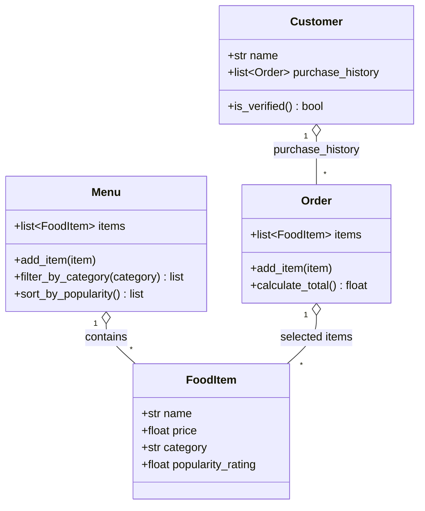

# ByteBites Design (Final UML)

## One-sentence roles
- **Customer**: a user with a name and past orders; verified if they have purchase history.
- **FoodItem**: one sellable item with name, price, category, popularity rating.
- **Menu**: the full collection of items, filterable by category and sortable by popularity.
- **Order**: a single transaction holding selected items and computing the total.
