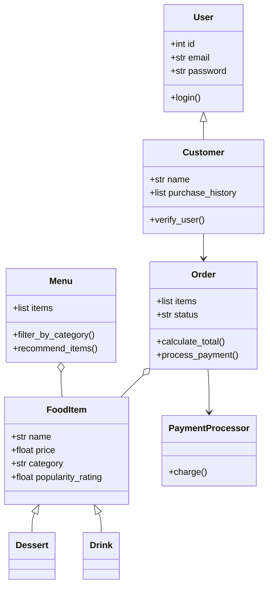

# Draft from AI (no reference file)

First-pass diagram from plain chat, before adding the reference file. Note the extra classes and inheritance not in the spec.

## Problems
- Adds classes not in the spec (User, Dessert, Drink, PaymentProcessor).
- Uses inheritance where simple attributes work (category is just a string).
- Adds features not requested (login, recommend_items, process_payment, status).
